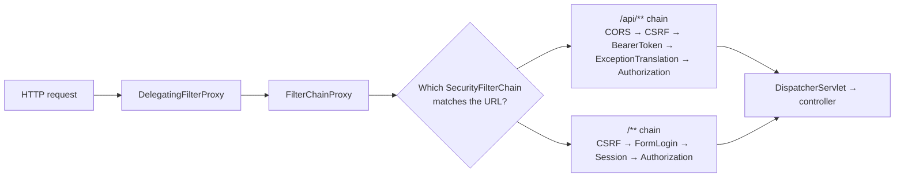
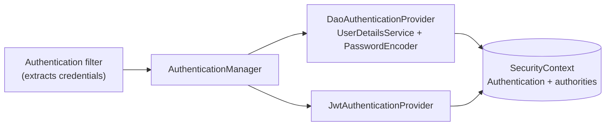

## Authentication vs authorization

- **Authentication** — *who are you?* Verifying identity (password, token, certificate).
- **Authorization** — *what may you do?* Checking permissions for a request or method.

Spring Boot 4 ships **Spring Security 7**. Adding `spring-boot-starter-security` immediately secures every endpoint: all requests need authentication, a login form and HTTP Basic are enabled, and a random password is printed at startup. You then replace those defaults with your own `SecurityFilterChain`.

## Architecture: a chain of filters



Spring Security is a [Chain of Responsibility](/design-patterns/chain-of-responsibility/): a servlet filter delegates to one of your `SecurityFilterChain`s, each a list of filters. Authentication filters populate the **`SecurityContext`** (held in a `ThreadLocal` via `SecurityContextHolder`); the `AuthorizationFilter` near the end decides whether the request may proceed.



## Configuring a SecurityFilterChain

```java
@Configuration
@EnableWebSecurity
@EnableMethodSecurity                                   // enables @PreAuthorize
class SecurityConfig {

    @Bean
    SecurityFilterChain api(HttpSecurity http) throws Exception {
        return http
            .securityMatcher("/api/**")
            .authorizeHttpRequests(auth -> auth
                .requestMatchers(HttpMethod.GET, "/api/products/**").permitAll()
                .requestMatchers("/api/admin/**").hasRole("ADMIN")
                .requestMatchers(HttpMethod.POST, "/api/orders").hasAuthority("SCOPE_orders:write")
                .anyRequest().authenticated())
            .oauth2ResourceServer(oauth -> oauth.jwt(Customizer.withDefaults()))   // stateless JWT auth
            .sessionManagement(s -> s.sessionCreationPolicy(SessionCreationPolicy.STATELESS))
            .csrf(csrf -> csrf.disable())                  // OK for stateless token APIs only
            .cors(Customizer.withDefaults())
            .build();
    }

    @Bean
    SecurityFilterChain actuator(HttpSecurity http) throws Exception {
        return http
            .securityMatcher(EndpointRequest.toAnyEndpoint())
            .authorizeHttpRequests(auth -> auth
                .requestMatchers(EndpointRequest.to("health", "info")).permitAll()
                .anyRequest().hasRole("OPS"))
            .httpBasic(Customizer.withDefaults())
            .build();
    }
}
```

<Callout type="tip">
Rules are evaluated **top to bottom, first match wins** — put specific matchers before general ones, and end with `anyRequest()`. Prefer deny-by-default (`anyRequest().authenticated()` or `.denyAll()`).
</Callout>

## Users and passwords

For username/password login, provide a `UserDetailsService` and a `PasswordEncoder`:

```java
@Bean
PasswordEncoder passwordEncoder() {
    return PasswordEncoderFactories.createDelegatingPasswordEncoder();   // bcrypt by default, upgradeable
}

@Bean
UserDetailsService users(UserRepository repo) {
    return username -> repo.findByEmail(username)
        .map(u -> User.withUsername(u.getEmail())
                      .password(u.getPasswordHash())            // e.g. "{bcrypt}$2a$10$..."
                      .roles(u.getRoles().toArray(String[]::new))
                      .build())
        .orElseThrow(() -> new UsernameNotFoundException(username));
}
```

<Callout type="danger" title="Never store plain or fast-hashed passwords">
Use an adaptive, salted hash — **bcrypt**, **scrypt** or **Argon2** — via `PasswordEncoder`. MD5/SHA-256 are far too fast to resist brute force. The `DelegatingPasswordEncoder` stores the algorithm id (`{bcrypt}`) so you can migrate algorithms over time.
</Callout>

## Roles vs authorities

An `Authentication` carries a list of `GrantedAuthority` strings. A **role** is just an authority with the `ROLE_` prefix: `hasRole("ADMIN")` checks for `ROLE_ADMIN`. JWT scopes become `SCOPE_…` authorities by default.

## Method security

```java
@Service
class AccountService {
    @PreAuthorize("hasRole('ADMIN') or #accountId == authentication.name")
    public Account get(String accountId) { ... }

    @PreAuthorize("hasAuthority('SCOPE_payments:write')")
    public Transfer transfer(TransferCommand cmd) { ... }

    @PostAuthorize("returnObject.ownerId == authentication.name")
    public Document load(long id) { ... }
}
```

Method security uses AOP proxies — the same self-invocation caveat as `@Transactional` applies.

## CSRF and CORS

- **CSRF** protects **cookie/session-based** apps from cross-site forged requests. Keep it enabled for browser apps with sessions; it's safe to disable for **stateless APIs authenticated by an `Authorization` header** (browsers don't attach that header automatically).
- **CORS** controls which *other origins* a browser lets call your API. Configure it explicitly:

```java
@Bean
CorsConfigurationSource corsConfigurationSource() {
    var config = new CorsConfiguration();
    config.setAllowedOrigins(List.of("https://app.shop.example"));
    config.setAllowedMethods(List.of("GET", "POST", "PATCH", "DELETE"));
    config.setAllowedHeaders(List.of("Authorization", "Content-Type"));
    var source = new UrlBasedCorsConfigurationSource();
    source.registerCorsConfiguration("/api/**", config);
    return source;
}
```

## Accessing the current user

```java
@GetMapping("/api/me")
MeResponse me(@AuthenticationPrincipal Jwt jwt) {
    return new MeResponse(jwt.getSubject(), jwt.getClaimAsString("email"));
}
```

Elsewhere: `SecurityContextHolder.getContext().getAuthentication()`. Note the context is thread-bound — with `@Async` or custom executors, propagate it (e.g. `DelegatingSecurityContextExecutor`; Spring Boot's task executors and virtual-thread setup can do this for you).

<Callout type="interview">
*“Explain the Spring Security architecture”* — `DelegatingFilterProxy` → `FilterChainProxy` → matching `SecurityFilterChain`; authentication filters → `AuthenticationManager` → `AuthenticationProvider`s → `SecurityContext`; `AuthorizationFilter` checks rules. Also: *“authentication vs authorization”*, *“`hasRole` vs `hasAuthority`”*, *“When can you disable CSRF?”*, *“How are passwords stored?”*.
</Callout>
