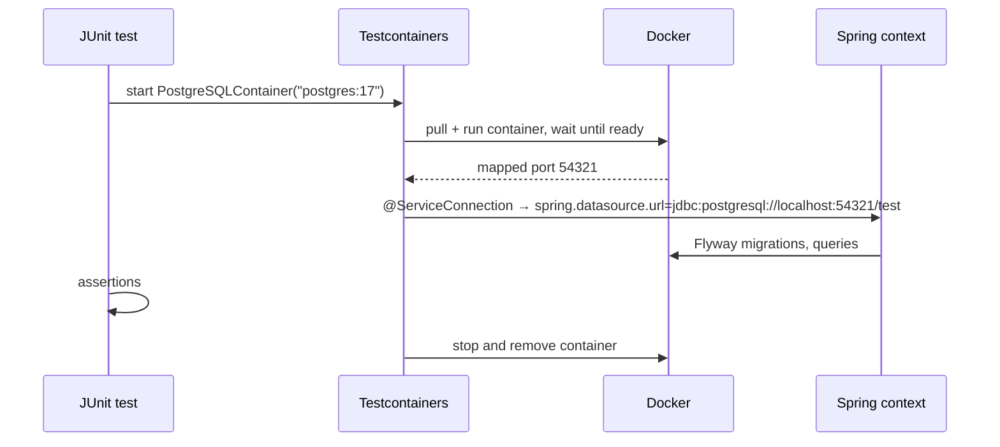

## Why real dependencies?

Mocks and in-memory substitutes (H2, embedded Kafka) test *your assumptions* about a dependency, not the dependency. **Testcontainers** starts real services in throwaway Docker containers for the duration of a test run: the same PostgreSQL version, the same Kafka broker, the same Redis you run in production.



## Dependencies

```xml
<dependency>
    <groupId>org.springframework.boot</groupId>
    <artifactId>spring-boot-testcontainers</artifactId>
    <scope>test</scope>
</dependency>
<dependency>
    <groupId>org.testcontainers</groupId>
    <artifactId>testcontainers-postgresql</artifactId>
    <scope>test</scope>
</dependency>
<dependency>
    <groupId>org.testcontainers</groupId>
    <artifactId>testcontainers-junit-jupiter</artifactId>
    <scope>test</scope>
</dependency>
```

Versions are managed by Spring Boot's dependency management.

## @ServiceConnection — zero property wiring

Declare containers as beans in a test configuration. `@ServiceConnection` tells Boot to derive the connection details (URL, username, password, bootstrap servers…) from the running container — no `@DynamicPropertySource` boilerplate.

```java
@TestConfiguration(proxyBeanMethods = false)
public class TestcontainersConfig {

    @Bean
    @ServiceConnection
    PostgreSQLContainer postgres() {
        return new PostgreSQLContainer("postgres:17-alpine");
    }

    @Bean
    @ServiceConnection
    KafkaContainer kafka() {
        return new KafkaContainer("apache/kafka-native:3.9.0");
    }

    @Bean
    @ServiceConnection(name = "redis")
    GenericContainer<?> redis() {
        return new GenericContainer<>("redis:7-alpine").withExposedPorts(6379);
    }
}
```

Use it from any test:

```java
@SpringBootTest
@Import(TestcontainersConfig.class)
class OrderPlacementIT {
    @Autowired OrderService orders;
    @Autowired OrderRepository repository;

    @Test
    void persistsOrderAndPublishesEvent() {
        var id = orders.placeOrder(new PlaceOrder("c-1", List.of(new Item("BOOK-1", 1))));
        assertThat(repository.findById(id.value())).isPresent();
        // assert on the Kafka topic with a test consumer or Awaitility…
    }
}
```

Containers declared as beans are started once per application context and shared by every test class that reuses that context.

## Run the app locally with the same containers

Testcontainers can also back your **development** run. Create a test-scope main class:

```java
public class TestShopApplication {
    public static void main(String[] args) {
        SpringApplication.from(ShopApplication::main)
            .with(TestcontainersConfig.class)
            .run(args);
    }
}
```

Run it from the IDE (or `./mvnw spring-boot:test-run`) and you get PostgreSQL, Kafka and Redis without installing anything.

### Or Docker Compose support

Alternatively, add `spring-boot-docker-compose` and a `compose.yaml` at the project root. On startup, Boot runs `docker compose up`, waits for the services and creates connection details automatically:

```yaml
services:
  postgres:
    image: postgres:17-alpine
    environment:
      POSTGRES_DB: shop
      POSTGRES_USER: shop
      POSTGRES_PASSWORD: secret
    ports: ["5432"]
```

## Faster feedback

- **Singleton containers / shared config** — one container set for the whole suite via a shared `@TestConfiguration`
- **Reuse between runs** — `.withReuse(true)` plus `testcontainers.reuse.enable=true` in `~/.testcontainers.properties` keeps containers alive across test runs locally (never in CI)
- **Small images** — `-alpine` variants, `kafka-native` images start in about a second
- **Parallel CI** — Testcontainers works in GitHub Actions, GitLab CI and Jenkins agents with Docker available

<Callout type="tip" title="Database migrations are part of the test">
With Flyway or Liquibase on the classpath, migrations run against the container on context startup — so an integration test also verifies that your migration scripts work on the real database engine.
</Callout>

<Callout type="interview">
*“How do you write integration tests for a Spring Boot service with a database and Kafka?”* — `@SpringBootTest` with Testcontainers, `@ServiceConnection` for automatic connection details, Flyway migrations on startup, Awaitility for asynchronous assertions, and context caching to keep suites fast. Explain why H2 or mocks aren't enough.
</Callout>
