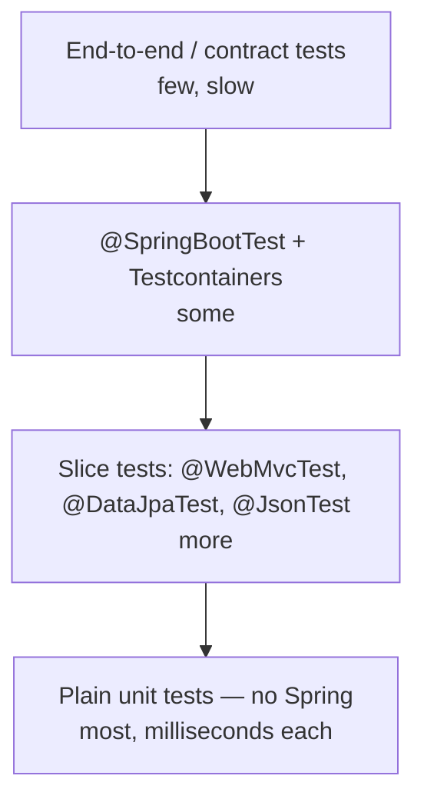

## The pyramid



Constructor injection makes the bottom layer easy: **most business logic should be testable without starting Spring at all.**

```java
class PricingServiceTest {
    private final TaxRates taxRates = mock(TaxRates.class);
    private final PricingService pricing = new PricingService(taxRates, Clock.fixed(Instant.parse("2026-01-01T00:00:00Z"), UTC));

    @Test
    void appliesVat() {
        given(taxRates.rateFor("GB")).willReturn(new BigDecimal("0.20"));
        assertThat(pricing.gross(new BigDecimal("10.00"), "GB")).isEqualByComparingTo("12.00");
    }
}
```

`spring-boot-starter-test` includes **JUnit Jupiter**, **AssertJ**, **Mockito**, **Hamcrest**, **JSONassert/JsonPath** and Spring Test. In Spring Boot 4, each technology also has a focused test starter (for example `spring-boot-starter-webmvc-test`, `spring-boot-starter-data-jpa-test`) that brings its slice annotations.

## Mocks in the Spring context: @MockitoBean

Spring Boot 4 **removed** `@MockBean` and `@SpyBean` (deprecated in 3.4). Use the Spring Framework replacements:

| Boot 3 (removed) | Boot 4 |
| --- | --- |
| `@MockBean` | **`@MockitoBean`** |
| `@SpyBean` | **`@MockitoSpyBean`** |

They replace (or wrap) the bean of that type in the test's application context.

## Web layer: @WebMvcTest

Starts only MVC infrastructure — controllers, advice, converters, filters, security — not services or repositories.

```java
@WebMvcTest(OrderController.class)
class OrderControllerTest {

    @Autowired MockMvcTester mvc;                 // AssertJ-friendly MockMvc (Framework 6.2+)
    @MockitoBean OrderService orders;

    @Test
    void createsOrder() {
        given(orders.create(any())).willReturn(new OrderResponse(42, "c-1", OrderStatus.NEW, new BigDecimal("39.98"), Instant.EPOCH));

        assertThat(mvc.post().uri("/api/orders")
                .contentType(MediaType.APPLICATION_JSON)
                .content("""
                    {"customerId": "c-1", "items": [{"sku": "BOOK-1", "quantity": 2}]}
                    """))
            .hasStatus(HttpStatus.CREATED)
            .hasHeader("Location", "http://localhost/api/orders/42")
            .bodyJson().extractingPath("$.total").asNumber().isEqualTo(39.98);
    }

    @Test
    void rejectsInvalidPayload() {
        assertThat(mvc.post().uri("/api/orders").contentType(MediaType.APPLICATION_JSON).content("{\"items\": []}"))
            .hasStatus(HttpStatus.BAD_REQUEST)
            .bodyJson().extractingPath("$.errors").asArray().isNotEmpty();
    }
}
```

## Persistence layer: @DataJpaTest

Starts JPA, Spring Data repositories, Flyway/Liquibase and a `TestEntityManager`. Each test runs in a transaction that is **rolled back** afterwards.

```java
@DataJpaTest
@AutoConfigureTestDatabase(replace = Replace.NONE)   // use the real DB from Testcontainers, not H2
@Import(TestcontainersConfig.class)
class OrderRepositoryTest {
    @Autowired OrderRepository repository;
    @Autowired TestEntityManager em;

    @Test
    void findsLargePaidOrders() {
        var big = new Order("c-1"); big.addLine("DESK", 1, new BigDecimal("250")); big.markPaid();
        var small = new Order("c-2"); small.addLine("PEN", 1, new BigDecimal("2")); small.markPaid();
        em.persist(big); em.persist(small); em.flush(); em.clear();

        assertThat(repository.findLargeOrders(OrderStatus.PAID, new BigDecimal("100"), Limit.of(10)))
            .extracting(Order::getCustomerId).containsExactly("c-1");
    }
}
```

<Callout type="warn" title="H2 lies">
An in-memory H2 database behaves differently from PostgreSQL or MySQL (SQL dialect, locking, JSON types, constraints). Tests pass, production fails. Run repository tests against the **same database engine** using Testcontainers — see the next lesson.
</Callout>

## Other slices

| Annotation | Loads |
| --- | --- |
| `@JsonTest` | Jackson configuration — test (de)serialisation of DTOs |
| `@RestClientTest` | `RestClient`/`RestTemplate` builders + `MockRestServiceServer` |
| `@WebFluxTest` | WebFlux controllers + `WebTestClient` |
| `@DataJdbcTest`, `@DataMongoTest`, `@DataRedisTest` | The respective data layer |
| `@GraphQlTest` | GraphQL controllers |

## Full integration: @SpringBootTest

```java
@SpringBootTest(webEnvironment = WebEnvironment.RANDOM_PORT)
@AutoConfigureRestTestClient
@Import(TestcontainersConfig.class)
class CheckoutFlowIT {

    @Autowired RestTestClient client;            // Spring Framework 7: one client for MockMvc or live servers

    @Test
    void placesAndFetchesOrder() {
        var location = client.post().uri("/api/orders")
            .contentType(MediaType.APPLICATION_JSON)
            .body(new CreateOrderRequest("c-1", List.of(new LineItemRequest("BOOK-1", 1)), null))
            .exchange()
            .expectStatus().isCreated()
            .returnResult(Void.class).getResponseHeaders().getLocation();

        client.get().uri(location).exchange()
            .expectStatus().isOk()
            .expectBody().jsonPath("$.status").isEqualTo("NEW");
    }
}
```

<Callout type="tip" title="Keep the test suite fast">
Spring caches application contexts **between test classes** with identical configuration. Every distinct combination of `@MockitoBean`s, properties and profiles creates a new context. Standardise a few base configurations, and avoid sprinkling unique mocks across dozens of `@SpringBootTest` classes.
</Callout>

## Testing other concerns

- **Time** — inject a `Clock` and use `Clock.fixed(...)` in tests
- **Security** — `spring-security-test`: `@WithMockUser`, `.with(jwt())`, `.with(csrf())`
- **Async** — Awaitility: `await().atMost(5, SECONDS).untilAsserted(() -> ...)`
- **Properties** — `@TestPropertySource`, `@DynamicPropertySource`, or `ApplicationContextRunner` for auto-configuration

<Callout type="interview">
*“`@SpringBootTest` vs `@WebMvcTest` vs `@DataJpaTest`?”* — full context vs web slice vs JPA slice. *“`@MockBean` vs `@MockitoBean`?”* — `@MockBean` was Spring Boot's and is gone in Boot 4; `@MockitoBean` is Spring Framework's replacement. *“`@Mock` vs `@MockitoBean`?”* — a plain Mockito mock vs a mock registered as a bean in the Spring context. *“How do you speed up Spring tests?”* — more unit and slice tests, context caching, Testcontainers reuse.
</Callout>
