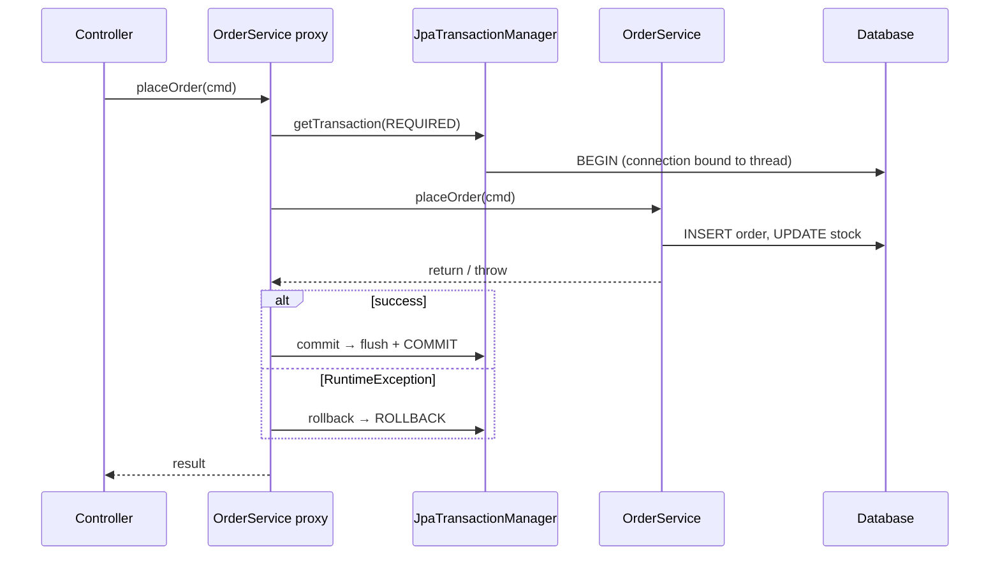

## ACID in one table

| Property | Guarantee |
| --- | --- |
| **Atomicity** | All statements commit or none do |
| **Consistency** | Constraints hold before and after |
| **Isolation** | Concurrent transactions don't see each other's intermediate state (to a configurable degree) |
| **Durability** | Committed data survives crashes |

## How @Transactional works

`@Transactional` is implemented with an **AOP proxy** (see [Spring AOP & Proxies](/spring-boot/spring-aop/)). Calls into the bean go through a `TransactionInterceptor` that asks the `PlatformTransactionManager` (`JpaTransactionManager` with JPA) to begin, commit or roll back.



```java
@Service
class OrderService {
    @Transactional
    public OrderId placeOrder(PlaceOrder cmd) {
        Order order = orders.save(new Order(cmd.customerId()));
        cmd.items().forEach(i -> {
            inventory.reserve(i.sku(), i.qty());   // throws InsufficientStockException → everything rolls back
            order.addLine(i.sku(), i.qty(), prices.of(i.sku()));
        });
        return order.id();
    }

    @Transactional(readOnly = true)
    public OrderView get(long id) { ... }
}
```

<Callout type="tip" title="readOnly = true">
For queries, `readOnly = true` lets Hibernate skip dirty checking and snapshotting of loaded entities (less CPU and memory), and lets the JDBC driver/database optimise. It's also a clear signal to readers. A common convention: `@Transactional(readOnly = true)` on the class, `@Transactional` on write methods.
</Callout>

## Rollback rules

By default Spring rolls back on **unchecked exceptions** (`RuntimeException`, `Error`) and **commits** on checked exceptions — a frequent surprise.

```java
@Transactional(rollbackFor = Exception.class)          // also roll back for checked exceptions
@Transactional(noRollbackFor = NotificationFailedException.class)
```

Catching an exception inside the method and not rethrowing means the proxy never sees it — the transaction **commits**. If an inner `REQUIRED` method throws and an outer method catches it, the shared transaction is already marked **rollback-only**, and the outer commit fails with `UnexpectedRollbackException`.

## Propagation

What happens when a transactional method calls another transactional method?

| Propagation | Behaviour | Use for |
| --- | --- | --- |
| **`REQUIRED`** (default) | Join the current transaction, or start one | Almost everything |
| **`REQUIRES_NEW`** | Suspend the current one and start an independent transaction | Audit logs / outbox entries that must persist even if the caller rolls back |
| `NESTED` | Savepoint inside the current transaction (JDBC savepoints) | Partial rollback of a step |
| `SUPPORTS` | Join if one exists, else run without | Read helpers |
| `MANDATORY` | Must be called within a transaction, else throw | Enforcing that callers manage the transaction |
| `NOT_SUPPORTED` | Suspend any transaction, run without | Long non-transactional work |
| `NEVER` | Throw if a transaction exists | |

```java
@Service
class AuditService {
    @Transactional(propagation = Propagation.REQUIRES_NEW)
    public void record(String event) { auditRepository.save(new AuditEntry(event)); }
}
```

<Callout type="warn">
`REQUIRES_NEW` takes a **second database connection** while the first is suspended. Under load this can exhaust the connection pool and deadlock the application. Use it deliberately.
</Callout>

## Isolation levels

| Level | Dirty read | Non-repeatable read | Phantom read |
| --- | --- | --- | --- |
| `READ_UNCOMMITTED` | possible | possible | possible |
| **`READ_COMMITTED`** (PostgreSQL, Oracle, SQL Server default) | ✗ | possible | possible |
| `REPEATABLE_READ` (MySQL InnoDB default) | ✗ | ✗ | possible* |
| `SERIALIZABLE` | ✗ | ✗ | ✗ |

\* InnoDB and PostgreSQL's snapshot implementations prevent most phantoms at `REPEATABLE_READ`.

Rather than raising isolation globally, protect specific invariants: **optimistic locking** with `@Version`, **pessimistic locking** with `@Lock(LockModeType.PESSIMISTIC_WRITE)` (`SELECT … FOR UPDATE`), or atomic SQL (`update stock set qty = qty - :n where sku = :sku and qty >= :n`).

## Common pitfalls

1. **Self-invocation** — calling a `@Transactional` method from the same class bypasses the proxy.
2. **Non-public methods** — annotations on `private` methods are ignored (proxies can't intercept them).
3. **Checked exceptions commit** unless `rollbackFor` is set.
4. **Swallowed exceptions** — catching without rethrowing commits partial work.
5. **Long transactions** — remote HTTP calls inside a transaction hold a DB connection and locks for the duration. Do I/O before or after.
6. **Side effects before commit** — sending an email or Kafka message inside the transaction, then rolling back. Use `@TransactionalEventListener(phase = AFTER_COMMIT)` or the **transactional outbox** pattern.
7. **`@Transactional` on controllers** — keep transaction boundaries in the service layer.

## Programmatic transactions

```java
@Service
class ImportService {
    private final TransactionTemplate tx;
    ImportService(PlatformTransactionManager tm) { this.tx = new TransactionTemplate(tm); }

    void importAll(List<Row> rows) {
        for (List<Row> chunk : chunks(rows, 500)) {
            tx.executeWithoutResult(status -> chunk.forEach(this::upsert));   // one transaction per chunk
        }
    }
}
```

<Callout type="interview">
Expect a combination of: *“How does `@Transactional` work?”* (proxy + transaction manager), *“Default propagation and rollback behaviour?”* (`REQUIRED`; rollback on unchecked only), *“`REQUIRED` vs `REQUIRES_NEW`?”*, *“Isolation levels and the anomalies they prevent?”*, *“Why doesn't my transaction roll back / start?”* (self-invocation, private method, checked exception, swallowed exception).
</Callout>
