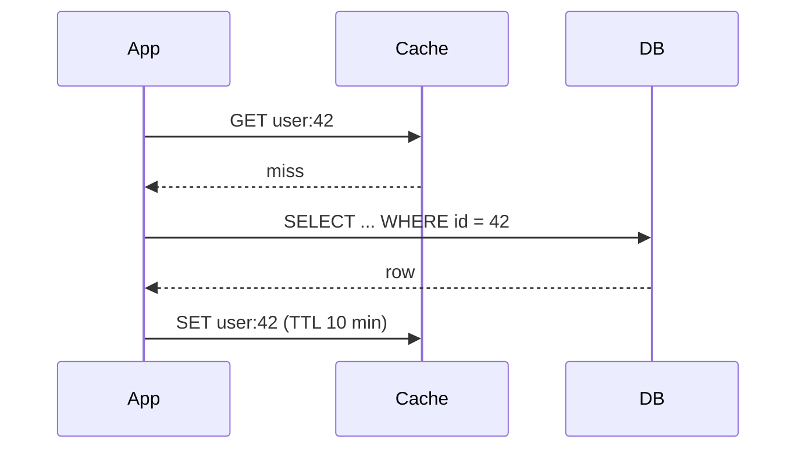

## Where caches live

| Layer | Example | Caches |
| --- | --- | --- |
| Client | Browser cache, mobile store | Static assets, API responses with `Cache-Control` |
| Edge | CDN | Images, JS/CSS, public API responses |
| Application | In-process (Caffeine) | Hot config, small reference data |
| Distributed | Redis, Memcached | Sessions, query results, computed objects |
| Database | Buffer pool | Pages of tables and indexes |

A cache is worth it when the data is **read far more than written** and **some staleness is acceptable**.

## Read and write patterns

### Cache-aside (lazy loading) — the default

The application owns the logic: read the cache, on miss read the DB and populate. On writes, **update the DB then delete the cache key** (deleting is safer than updating — it avoids racing writers leaving a stale value).

### Other patterns

| Pattern | How | Good for | Risk |
| --- | --- | --- | --- |
| Read-through | Cache library loads from DB on miss | Simpler app code | Same as cache-aside |
| Write-through | Write cache and DB synchronously | Read-after-write consistency | Slower writes; caches cold data |
| Write-behind (write-back) | Write cache, flush to DB asynchronously | Very high write rates, counters | Data loss if the cache dies before flushing |
| Refresh-ahead | Refresh hot keys before they expire | Predictable hot data | Wasted work on keys nobody reads |

## Eviction and expiry

- **LRU** (least recently used) — the usual default. **LFU** keeps frequently-used items, better for stable popularity.
- **TTL** bounds staleness even if invalidation fails. Add **jitter** (e.g. 10 min ± 60 s) so keys written together don't expire together.

## Invalidation — the hard part

> There are only two hard things in computer science: cache invalidation and naming things.

Options, from simplest to most precise:

1. **TTL only** — accept up to N seconds of staleness.
2. **Delete on write** — the writer deletes the key after committing.
3. **Event-driven** — consume the DB change stream (CDC, e.g. Debezium) and invalidate; catches writes from every service.
4. **Versioned keys** — `product:42:v7`; bumping the version makes old entries unreachable.

## Failure modes and fixes

| Problem | What happens | Fix |
| --- | --- | --- |
| **Stampede / thundering herd** | A hot key expires; thousands of requests miss at once and hammer the DB | Request coalescing (single-flight lock per key), early probabilistic refresh, stale-while-revalidate |
| **Hot key** | One key gets a huge share of traffic and overloads one cache node | Replicate the key across nodes (`key#1..N`), local in-process cache in front |
| **Penetration** | Requests for keys that don't exist always miss and hit the DB | Cache negative results briefly; Bloom filter of valid keys |
| **Avalanche** | Many keys expire together, or the cache cluster restarts cold | TTL jitter, warm-up, circuit breaker in front of the DB |

<Callout type="warn" title="The cache is not the source of truth">
Design so the system is still **correct** (just slower) if the cache is empty. If losing Redis loses data, it's a database — treat it like one (persistence, replication, backups).
</Callout>

<Callout type="interview">
A strong answer names the **hit ratio you expect** and why ("top 20% of URLs get 80% of traffic, so a cache sized for 20% of the working set should give ~80% hits"), the **invalidation strategy**, and **what happens on a stampede**.
</Callout>
