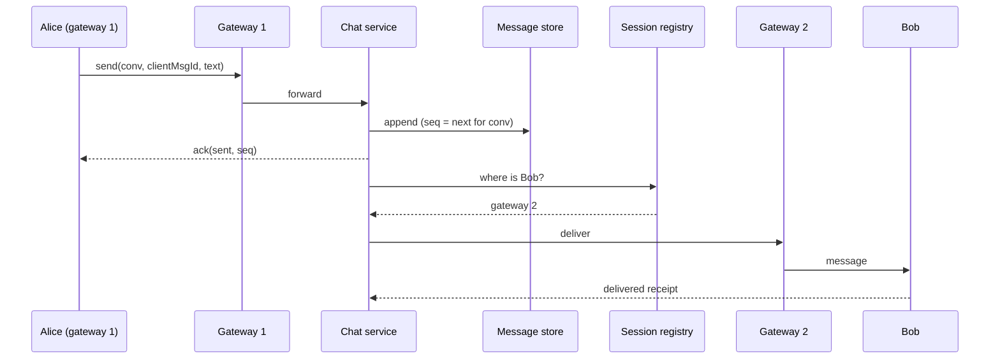

## 1. Requirements

**Functional:** 1:1 and group chats (up to ~500 members); online/last-seen presence; sent/delivered/read receipts; message history on all devices.

**Non-functional:** messages delivered in **under ~500 ms** when both users are online; **never lose** an acknowledged message; per-conversation **ordering**; works on flaky mobile networks.

## 2. Estimates

- 100M DAU, 50 messages/user/day → 5B/day → **~50K messages/s** (peak ~150K).
- ~100 bytes per message → 500 GB/day → **~180 TB/year** before replication.
- Up to 100M **concurrent connections**; at ~100K connections per gateway server → **~1,000 gateway servers**.

## 3. Connections

Clients keep a persistent **WebSocket** to a **chat gateway**. HTTP polling wastes requests; long polling works but is clumsy for bidirectional traffic.

A **session registry** (Redis) maps `userId → gatewayId` so any server can find where a recipient is connected.

## 4. High-level design

1. The sender's message gets a `clientMsgId` (for **idempotent retries**) and is persisted **before** it's acknowledged.
2. The chat service assigns a per-conversation **sequence number** — that defines ordering.
3. It looks up the recipient's gateway and pushes the message there. If the recipient is **offline**, it triggers a push notification instead.

## 5. Deep dive

### Storage
Messages are append-heavy, read by conversation in time order — a natural fit for a wide-column store (Cassandra/ScyllaDB; Discord famously moved to ScyllaDB) with **partition key `conversation_id`** (plus a time bucket for huge channels) and **clustering by sequence**.

### Ordering
Wall clocks across devices disagree. Use a **per-conversation sequence** assigned by the server that owns that conversation (route all writes for a conversation to one partition/leader). Clients display by sequence, not by local timestamp.

### Offline and multi-device sync
Each device stores the last sequence it has seen per conversation. On reconnect it asks *"give me everything after seq N"* — no message is lost even if pushes were missed.

### Group chats
For small groups, fan out to each member's gateway (write once to storage, deliver N times). For very large channels, don't push every message to every member — push a lightweight "new activity" signal and let clients pull.

### Presence
Gateways send heartbeats; presence is a TTL'd key per user (`online` while heartbeats arrive). Broadcast presence changes only to contacts who currently have the chat open, and debounce flaps — presence fan-out can easily exceed message volume.

## 6. Wrap-up trade-offs

- Persist-before-ack costs a few ms of latency but guarantees durability.
- Per-conversation sequencing gives ordering where users notice it, without global coordination.
- End-to-end encryption (Signal protocol) means the server can't search or moderate content — a product decision to raise explicitly.

<Callout type="interview">
Be ready for **"How does a message reach a user connected to a different server?"** (session registry + gateway routing, or a pub/sub channel per gateway) and **"How do you avoid losing or duplicating messages on retries?"** (persist before ack, client message IDs, sequence-based sync).
</Callout>
