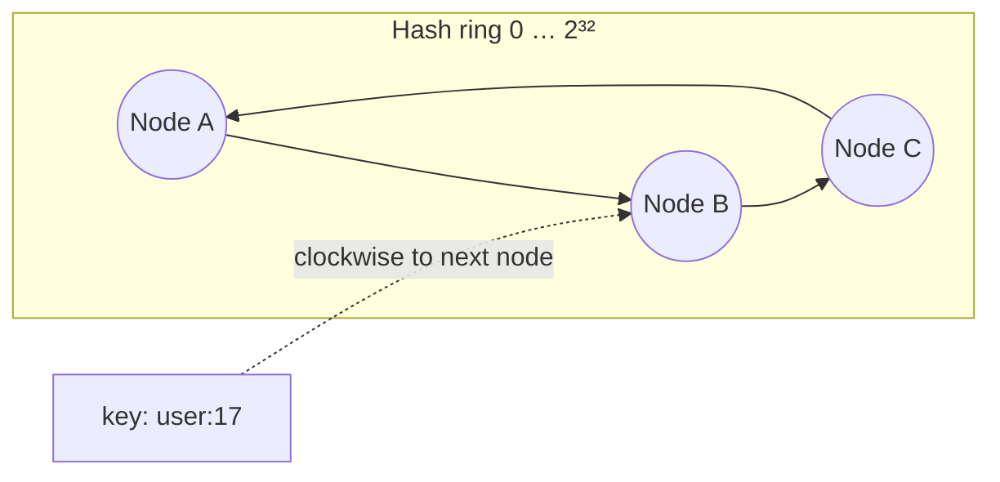

## Choosing a data store

| Need | Reach for | Why |
| --- | --- | --- |
| Transactions, joins, constraints | Relational (PostgreSQL, MySQL) | ACID, mature tooling, flexible queries |
| Massive write throughput, simple key access | Wide-column (Cassandra, ScyllaDB) | LSM-tree storage, leaderless, linear scale-out |
| Flexible documents | Document (MongoDB, DynamoDB) | Schema-flexible, partitioned by key |
| Sub-millisecond lookups | Key-value (Redis) | In-memory |
| Relationships many hops deep | Graph (Neo4j) | Traversals without join explosions |
| Full-text search | Search engine (Elasticsearch, OpenSearch) | Inverted indexes |
| Large binary objects | Object storage (S3) | Cheap, durable, effectively infinite |

**Start with a relational database** unless you can name the requirement it can't meet. Postgres comfortably handles terabytes and tens of thousands of queries per second with good indexes and read replicas.

## Replication

### Leader–follower (primary–replica)

All writes go to the **leader**; it streams changes to **followers**, which serve reads.

- **Synchronous** replication: no data loss on failover, but writes wait for a replica.
- **Asynchronous**: fast writes, but replicas lag — reads may be stale and a failover can lose the last few writes.

Handle **replication lag** with read-your-writes routing: read from the leader for a few seconds after a user writes, or route by the last-seen log position.

### Multi-leader and leaderless

- **Multi-leader** — a leader per region; low-latency local writes, but concurrent writes to the same row conflict (resolve with last-write-wins, CRDTs or app logic).
- **Leaderless** (Dynamo-style: Cassandra, Riak) — write to *W* of *N* replicas, read from *R*. If **R + W > N**, reads overlap the latest write. N=3, W=2, R=2 is a common balance.

## Partitioning (sharding)

Replication copies data; **sharding splits** it so each node holds a subset and handles a fraction of the load.

| Strategy | How | Pros | Cons |
| --- | --- | --- | --- |
| **Range** | Key ranges per shard (A–F, G–M…) | Efficient range scans | Hot spots on sequential keys (timestamps) |
| **Hash** | `hash(key) mod N` | Even distribution | Range queries scatter; changing N reshuffles almost everything |
| **Consistent hashing** | Keys and nodes on a ring | Adding a node moves only ~1/N of keys | Needs virtual nodes for balance |
| **Directory** | Lookup service maps key → shard | Total flexibility | The directory is a dependency to scale |

### Consistent hashing

Hash both nodes and keys onto a ring; a key belongs to the first node clockwise from it. Adding node D only takes keys from its clockwise neighbour. Each physical node gets many **virtual nodes** (100–200 points on the ring) so load stays even and a failed node's keys spread across many survivors. Used by Cassandra, DynamoDB, Discord and most distributed caches.

## Picking a shard key

A good shard key:

- Has **high cardinality** and spreads load evenly.
- Matches the **dominant access pattern** — the most common queries hit a single shard.
- Doesn't create **hot partitions** — avoid timestamps, country codes, or a celebrity's user ID as the only key.

Example: for a chat app, shard messages by `conversation_id` — fetching a conversation hits one shard. Sharding by `message_id` would scatter every conversation across all shards.

## Costs of sharding

- **Cross-shard queries and joins** become scatter-gather or denormalised read models.
- **Cross-shard transactions** need sagas or two-phase commit.
- **Resharding** is operationally heavy — plan for it (consistent hashing, many small logical shards mapped onto fewer physical nodes).
- **Unique IDs** can't come from one auto-increment; use Snowflake-style IDs (timestamp + machine ID + sequence) or UUIDv7.

<Callout type="interview">
Before you shard, say what you'd try first: **indexes → caching → read replicas → vertical scaling → functional partitioning** (split by table/service) → then sharding. Jumping straight to sharding without that ladder is a common red flag.
</Callout>
