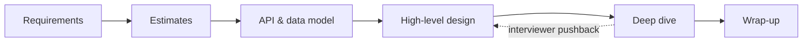

## There is no single right answer

A system design interview is a **collaborative design review**, not a quiz. The interviewer wants to see how you turn a vague prompt ("design Twitter") into a concrete, defensible architecture, and how you reason when they push back. Two candidates can draw very different diagrams and both pass. What separates them is **structure**, **trade-off reasoning** and **communication**.

## The 45-minute clock

Most loops give you 45–60 minutes. Budget it explicitly, and say the plan out loud at the start.

| Phase | Time | Goal | Output |
| --- | --- | --- | --- |
| 1. Requirements | ~5 min | Pin down scope | Functional + non-functional list |
| 2. Estimates | ~5 min | Know the scale | QPS, storage, bandwidth |
| 3. API & data model | ~5 min | Make it concrete | Endpoints, core entities |
| 4. High-level design | ~15 min | End-to-end happy path | Box-and-arrow diagram |
| 5. Deep dive | ~10 min | Prove depth on 1–2 hard parts | Bottlenecks, scaling, failure handling |
| 6. Wrap-up | ~5 min | Show judgement | Trade-offs, what you'd do next |



## 1. Clarify requirements

Split them into two lists and write both on the board.

- **Functional** — what the system does. "Users can post a tweet", "users see a home timeline". Pick the 2–4 that matter most and explicitly *descope* the rest ("I'll skip DMs and ads unless you want them").
- **Non-functional** — the qualities that drive the architecture: scale (DAU, read/write ratio), latency targets, availability, consistency, durability, cost.

Good clarifying questions change the design. "Is the feed allowed to be a few seconds stale?" matters; "what colour is the button?" doesn't.

<Callout type="tip" title="Ask about the read/write ratio">
Almost every design decision — caching, replication, fan-out strategy, storage engine — depends on whether the system is read-heavy or write-heavy. If you ask only one question, ask this one.
</Callout>

## 2. Back-of-envelope estimates

Convert users into **requests per second**, **storage per year** and **bandwidth**. You need order-of-magnitude numbers, not precision — they tell you whether one Postgres box is fine or you need sharding from day one. See [Back-of-Envelope Estimation](/system-design/back-of-envelope-estimation/) for the cheat sheet.

## 3. API and data model

Write 3–5 endpoints and the core entities. This forces precision and surfaces hidden requirements (pagination, idempotency keys, auth).

```http
POST /v1/tweets            { text, mediaIds[] }         -> 201 { tweetId }
GET  /v1/timeline?cursor=  -> 200 { tweets[], nextCursor }
POST /v1/follows           { followeeId }               -> 204
```

## 4. High-level design

Draw the **happy path end to end** before optimising anything: client → load balancer → stateless services → data stores, plus async pieces (queues, workers). Narrate a request as it flows through. Keep it simple — you'll add complexity in the deep dive.

## 5. Deep dive

Pick the one or two hardest parts (or let the interviewer pick) and go deep: the hot path at peak QPS, the data partitioning scheme, the failure modes. This is where senior candidates separate themselves. Typical deep-dive topics:

- Where is the **bottleneck** at 10× scale? What breaks first?
- What happens when a **node, a zone or a dependency fails**?
- How do you handle **hot keys**, **thundering herds** and **retries**?
- What **consistency** does each piece actually need?

## 6. Wrap up

Summarise the design in a sentence, name the **trade-offs you made** and why, and list what you'd do next with more time (monitoring, multi-region, cost optimisation). Ending with your own critique shows judgement.

## What interviewers score

| Signal | Weak | Strong |
| --- | --- | --- |
| Problem navigation | Jumps to drawing boxes | Scopes, estimates, then designs |
| Trade-offs | "Use Kafka because it scales" | "Kafka gives replay and fan-out; the cost is ops complexity and eventual consistency" |
| Depth | Names technologies | Explains *how* they work and fail |
| Communication | Silent drawing | Thinks aloud, checks in, adapts to hints |

<Callout type="interview">
When you're unsure, **state an assumption and move on**: "I'll assume 100M DAU and a 100:1 read/write ratio — tell me if that's off." Stalling to search for the 'right' number costs more than a wrong assumption you can revise.
</Callout>

## Practise

Drill the estimation phase in the [Napkin Math speed round](/quiz/napkin-math/) and the trade-off phase in [Trade-off Duels](/quiz/tradeoff-duels/). Both award XP and badges on your [progress page](/progress/).
