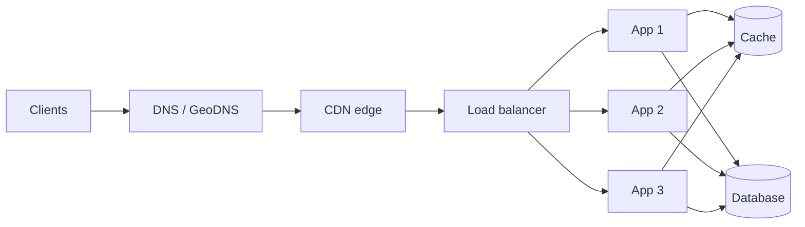

## The request path

Each hop removes load from the next: the **CDN** serves static and cacheable content at the edge, the **load balancer** spreads dynamic traffic across **stateless** app servers, the **cache** absorbs repeated reads, and only what's left reaches the **database**.

## L4 vs L7 load balancing

| | Layer 4 (transport) | Layer 7 (application) |
| --- | --- | --- |
| Sees | IP + port, TCP/UDP | HTTP method, path, headers, cookies |
| Can do | Fast connection forwarding | Path routing, TLS termination, retries, rate limiting, auth |
| Cost | Very cheap, very fast | More CPU per request |
| Examples | AWS NLB, IPVS | AWS ALB, NGINX, Envoy, HAProxy (HTTP mode) |

Large systems often stack them: an L4 tier spreads connections across a fleet of L7 proxies.

## Balancing algorithms

- **Round robin / weighted round robin** — simple, good when requests cost about the same.
- **Least connections / least outstanding requests** — better when request cost varies (some take 5 ms, some 5 s).
- **Power of two choices** — pick two backends at random, send to the less loaded one. Nearly as good as global least-load without coordination.
- **Consistent hashing** — the same key (user ID, session) goes to the same backend; useful for cache locality. See [Databases, Replication & Sharding](/system-design/databases-sharding/).

## Health checks and failure handling

The load balancer probes each backend (e.g. `GET /actuator/health/readiness` in Spring Boot) and stops routing to failures. Distinguish:

- **Liveness** — is the process alive? Failing means restart it.
- **Readiness** — can it serve traffic right now (warm caches, DB reachable)? Failing means take it out of rotation, not kill it.

Use **connection draining** on deploys so in-flight requests finish before an instance is removed.

## Keep services stateless

If a server keeps session state in memory, every request from that user must hit the same server (**sticky sessions**). That breaks even load distribution and loses sessions when the node dies. Instead, move state out:

- Sessions → a shared store (Redis) or a signed token (JWT) the client carries.
- Uploads → object storage, not local disk.
- Background work → a queue, not an in-process thread.

Stateless servers can be added, removed and replaced freely — which makes **autoscaling** possible.

## Autoscaling

Scale on a signal that leads load: CPU, requests per instance, or queue depth. Watch out for:

- **Cold starts** — new instances need time (JIT warm-up, cache fill). Scale early, keep headroom.
- **Downstream limits** — 10× app servers means 10× DB connections. Use connection pooling and a proxy (PgBouncer, RDS Proxy).
- **Flapping** — add cool-down periods so the fleet doesn't oscillate.

## CDN and API gateway

- A **CDN** caches static assets and cacheable API responses at edge locations close to users — cutting latency and origin egress. Use versioned URLs (`app.3f9c.js`) so you can cache forever.
- An **API gateway** is an L7 entry point that centralises cross-cutting concerns: authentication, [rate limiting](/system-design/rate-limiter/), request routing to microservices, and API versioning.

<Callout type="interview">
"Add a load balancer" earns nothing on its own. Say **what it balances on**, **how it detects failures**, and **why your servers can be stateless** — that's the depth interviewers are probing for.
</Callout>
