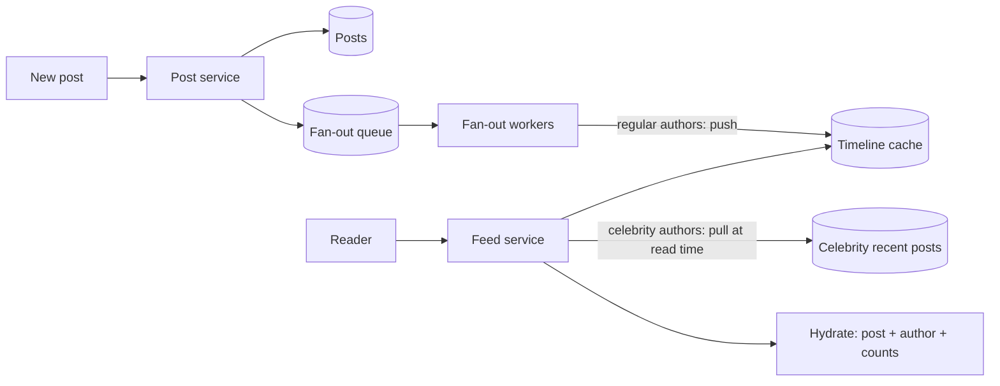

## 1. Requirements

**Functional:** users post; users follow others; users see a **home timeline** of posts from people they follow, newest (or best) first.

**Non-functional:** timeline loads in **under ~200 ms**; read-heavy; a few seconds of staleness is fine; posting must be durable.

## 2. Estimates

- 200M DAU; each opens the feed 10×/day → 2B reads/day → **~20K feed reads/s** (peak ~50K).
- 1 post/user/day on average → 200M posts/day → **~2K posts/s**.
- Average 200 followers → fan-out of **~400K timeline inserts/s** if we push every post.
- A few accounts have **100M+ followers**.

## 3. API and data

```http
POST /v1/posts                 { text, media[] }  -> 201 { postId }
GET  /v1/feed?cursor=&limit=20 -> 200 { posts[], nextCursor }
```

- `posts` — sharded by `post_id` (Snowflake IDs are time-sortable).
- `follows` — `(follower_id, followee_id)`, indexed both ways.
- `timeline` cache — per user, a list of the latest ~800 post IDs.

## 4. The core decision: fan-out

| | Fan-out on write (push) | Fan-out on read (pull) |
| --- | --- | --- |
| On post | Insert post ID into every follower's timeline | Just store the post |
| On read | Read one precomputed list — fast | Query every followee's recent posts and merge — slow |
| Cost | Write amplification; wasted work for inactive followers | Expensive reads, hard to hit latency target |
| Breaks on | **Celebrities** (100M inserts per post) | Users following thousands of accounts |

### The hybrid answer



- **Push** for ordinary authors: async workers append the post ID to each follower's cached timeline (skip followers inactive for 30+ days).
- **Pull** for celebrities (above a follower threshold): at read time, fetch their recent posts and merge them into the precomputed timeline.
- **Hydrate** post IDs into full posts with a batch lookup against a post cache.

## 5. Deep dive

- **Timeline cache sizing**: 200M users × 800 IDs × 8 bytes ≈ **1.3 TB** — a Redis cluster. Only keep timelines for active users; rebuild cold ones on demand with a pull.
- **Pagination**: cursor-based (`?cursor=<last post id>`), never offset — new posts shift offsets and cause duplicates.
- **Ranking**: a ranked feed fetches a few hundred candidates (the same pipeline), scores them with a model (recency, affinity, engagement), and returns the top N. Cache the ranked page briefly.
- **Counts** (likes, replies) are eventually consistent: increment in Redis, flush to the DB in batches.
- **Deletes/unfollows**: filter at read time and clean up lazily, rather than rewriting millions of timelines.

## 6. Wrap-up trade-offs

- Push buys fast reads with write amplification; pull keeps writes cheap at the expense of read latency. The hybrid uses each where it's cheapest.
- Staleness of a few seconds is the price of async fan-out — acceptable for a feed, stated explicitly.

<Callout type="interview">
The **celebrity problem** is the point of this question. If you propose pure fan-out on write, expect "what happens when someone with 100M followers posts?" Get ahead of it by proposing the hybrid yourself.
</Callout>
