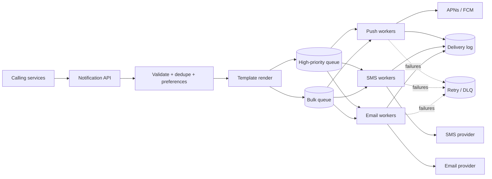

## 1. Requirements

**Functional:** other services send notifications to users over **push (APNs/FCM), SMS and email**; honour user **preferences** and quiet hours; templates with localisation; scheduled and bulk sends.

**Non-functional:** OTP and security alerts within **seconds**; marketing can wait; **no duplicate** sends; survive provider outages; ~10M notifications/day with campaign spikes of 10×.

## 2. Estimates

- 10M/day ≈ **~100/s** average; campaigns spike to **~1,000–5,000/s**.
- Third-party providers are the real bottleneck — each has its own rate limits and latency.

## 3. API

```http
POST /v1/notifications
{
  "userId": "u_42", "type": "order_shipped", "priority": "high",
  "data": { "orderId": "o_9" }, "idempotencyKey": "order_shipped:o_9"
}
-> 202 Accepted { notificationId }
```

Return **202** — sending is asynchronous.

## 4. High-level design



## 5. Deep dive

- **Deduplication**: store the `idempotencyKey` with a TTL (Redis `SET NX`); a retrying caller can't trigger a second send.
- **Preferences and quiet hours**: checked before enqueueing — opt-outs are a legal requirement (CAN-SPAM, GDPR), not a nice-to-have.
- **Priority isolation**: separate queues (and worker pools) for transactional vs bulk traffic, so a 5M-email campaign never delays a password-reset code.
- **Provider rate limits**: workers use a [token bucket](/system-design/rate-limiter/) per provider; back-pressure keeps messages in the queue instead of getting throttled.
- **Retries**: exponential backoff with jitter on transient errors; **failover** to a secondary SMS/email provider; permanent failures (invalid token, hard bounce) go to a DLQ and update the user's contact record.
- **At-least-once delivery** from queues means workers must check the delivery log before sending, to stay effectively-once.
- **Tracking**: provider callbacks (delivered, opened, bounced) update the delivery log for analytics.

## 6. Wrap-up trade-offs

- Async 202 API trades immediate confirmation for resilience to provider slowness.
- Per-channel workers let each scale and fail independently.
- Exactly-once to a third-party provider is impossible to guarantee; dedupe keys plus a delivery log make duplicates rare and bounded.

<Callout type="interview">
The two follow-ups to expect: **"How do you stop a marketing blast from delaying OTPs?"** (priority queues with isolated workers) and **"How do you prevent sending the same notification twice?"** (idempotency key + delivery log check).
</Callout>
