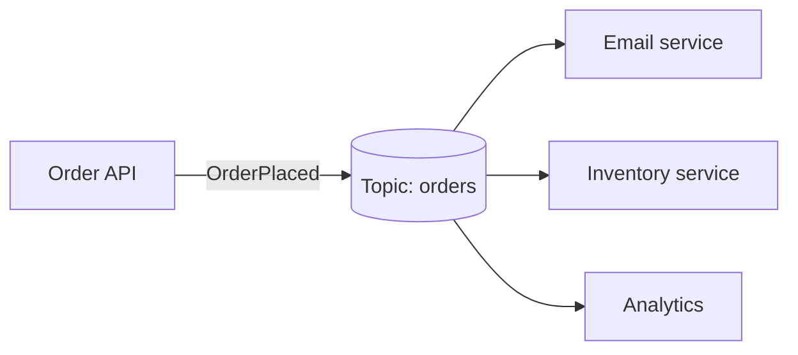

## Why go async?

Put a queue between two components when the caller **doesn't need the result right now**. You get:

- **Load levelling** — a spike fills the queue instead of crushing the consumer.
- **Decoupling** — the producer stays up when the consumer is down or slow.
- **Fan-out** — many independent consumers react to one event.
- **Retries** — failed work is redelivered instead of lost.

The cost: **eventual consistency**, harder debugging, and a broker to run.

## Queue vs log

| | Message queue (RabbitMQ, SQS) | Log / stream (Kafka, Kinesis, Pulsar) |
| --- | --- | --- |
| Model | Messages are removed once acknowledged | Append-only log, retained for days |
| Consumers | Compete for messages | Each group tracks its own offset |
| Replay | No | Yes — rewind the offset |
| Ordering | Per queue (best effort with competing consumers) | Per partition |
| Best for | Task distribution, work queues | Event streaming, fan-out, rebuilding read models |

## Delivery guarantees

- **At most once** — fire and forget; may lose messages.
- **At least once** — retry until acknowledged; may **duplicate**. The practical default.
- **Exactly once** — really "effectively once": at-least-once delivery + **idempotent processing** (or transactional writes within one system, like Kafka transactions).

### Make consumers idempotent

Processing the same message twice must have the same effect as once:

- Store processed message IDs (or an idempotency key) and skip duplicates — in the same transaction as the side effect.
- Prefer **absolute** updates (`set status = SHIPPED`) over **relative** ones (`balance = balance - 10`).
- Use upserts keyed by a natural ID.

## The dual-write problem and the outbox

"Write to the DB, then publish to Kafka" fails if the process crashes between the two — the order exists but nobody hears about it. The **transactional outbox** fixes it:

1. In the same DB transaction, insert the order **and** an `outbox` row describing the event.
2. A relay (polling, or CDC such as Debezium) publishes outbox rows to the broker and marks them sent.

Delivery is at-least-once, so consumers must still be idempotent.

## Ordering

Kafka guarantees order **within a partition**. Use the entity ID as the message key (`orderId`) so all events for one order land on one partition in order. Global ordering across all messages means one partition — and no parallelism.

## Back-pressure, retries and dead letters

- **Back-pressure** — monitor **consumer lag** (queue depth); autoscale consumers on it.
- **Retries with exponential backoff and jitter** — avoid synchronised retry storms.
- **Dead-letter queue (DLQ)** — after N failed attempts, park the message for inspection instead of blocking the partition forever (a "poison pill").

<Callout type="interview">
When you add a queue, say **which delivery guarantee** you get, **how consumers stay idempotent**, and **what happens to messages that keep failing**. Those three sentences cover most of the follow-up questions.
</Callout>
