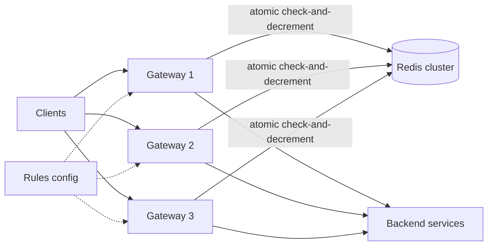

## 1. Requirements

- Limit requests per **client** (API key, user ID or IP) per rule, e.g. *100 requests/minute* per API key.
- Return **HTTP 429** with `Retry-After` and `RateLimit-*` headers when exceeded.
- Add **under ~1 ms** of latency; work across a fleet of gateway nodes.
- **Fail open** if the limiter's store is down (don't take the whole API down with it) — unless the limit protects something critical.

## 2. Where to enforce

- **API gateway / edge** — the usual place; one implementation for all services.
- **In the service** — when limits depend on business context (e.g. per-tenant plan tiers).
- **Client-side** — courtesy only; never trust it.

## 3. Algorithms

| Algorithm | Idea | Pros | Cons |
| --- | --- | --- | --- |
| **Token bucket** | Bucket of capacity *B* refills at *r* tokens/s; each request takes one | Allows controlled bursts; tiny state (tokens + timestamp) | Two parameters to tune |
| Leaky bucket | Requests queue and drain at a fixed rate | Smooth output rate | Bursts wait or are dropped; adds latency |
| Fixed window counter | Count per calendar minute | Simplest | 2× burst at window edges (end of one minute + start of the next) |
| Sliding window log | Store each request timestamp | Exact | Memory grows with traffic |
| **Sliding window counter** | Weighted mix of current and previous window counts | Near-exact, two counters | Approximation (assumes even spread) |

**Token bucket** (used by AWS, Stripe) and **sliding window counter** (used by Cloudflare) are the two answers to know.

Sliding window counter estimate:

```text
count ≈ current_window_count + previous_window_count × (1 − elapsed_fraction_of_current_window)
```

## 4. Distributed design



- State lives in **Redis**, keyed by `rl:{rule}:{clientId}`, sharded across the cluster by key.
- The check must be **atomic** — a read-then-write from two gateways at once lets both through. Use a **Lua script** (runs atomically in Redis) that refills the bucket based on elapsed time, decrements, and returns allowed/denied plus remaining tokens.
- Set a **TTL** on each key so idle clients cost nothing.
- Rules (limits per plan, per endpoint) are config pushed to gateways and cached in memory.

## 5. Deep dive: scale and latency

- 1M active clients × ~50 bytes = **~50 MB** of state — trivially fits in memory.
- One Redis round trip per request (~0.5 ms in-DC). To go further: **local token batching** — each gateway takes a small batch of tokens from Redis and spends them locally, trading a little accuracy for far fewer round trips.
- **Hot keys** (one huge client): give that client a local in-memory limiter per gateway with its share of the global limit.
- **Multi-region**: limit per region with a share of the global quota, or accept eventual consistency with async counter sync. Exact global limits across regions cost cross-region latency on every request.

## 6. Failure handling

- **Redis unavailable** → fail open with a conservative local limiter as a fallback, and alert.
- **Clock skew** — compute refill using Redis server time (`TIME`) inside the Lua script, not each gateway's clock.

<Callout type="interview">
Explain the **race condition** in a naive "GET count, then SET count+1" implementation and how a Lua script (or `INCR` + `EXPIRE` for fixed windows) makes it atomic. It's the most common deep-dive question for this problem.
</Callout>
