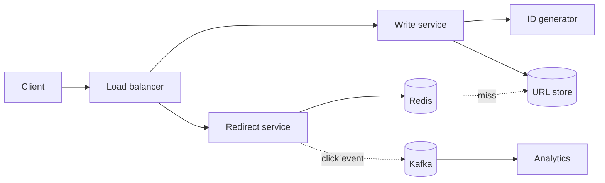

## 1. Requirements

**Functional**
- Given a long URL, return a short one (`sw.io/aZ3kP9q`).
- Visiting the short URL redirects to the original.
- Optional: custom aliases, expiry, click analytics.

**Non-functional**
- Very **read-heavy** (assume 100:1).
- Redirects must be **fast** (p99 under 50 ms) and **highly available** — a dead link breaks someone else's page.
- Short codes must be **unique** and preferably not guessable in sequence.

## 2. Estimates

- 100M new URLs/month → 100M ÷ 2.5M s ≈ **40 writes/s** (peak ~100).
- 100:1 → **~4,000 redirects/s** (peak ~10K).
- Each record ~500 bytes; 5 years = 6B URLs → **~3 TB**. Fits on a handful of nodes.
- Code length: base62 (a–z, A–Z, 0–9). 62⁷ ≈ 3.5 trillion — **7 characters** is plenty for 6B.

## 3. API

```http
POST /v1/urls        { longUrl, alias?, expiresAt? }  -> 201 { code, shortUrl }
GET  /{code}         -> 301/302 Location: <longUrl>
```

**301 vs 302**: a 301 (permanent) is cached by browsers, cutting load — but you lose click analytics. Use **302** if you count clicks.

## 4. High-level design



## 5. Deep dive: generating the code

| Approach | How | Pros | Cons |
| --- | --- | --- | --- |
| Hash the URL | `base62(md5(url))[0..7]` | Same URL → same code | Collisions need a check-and-retry loop |
| Random | 7 random base62 chars, insert if absent | Simple, unguessable | Collision probability grows; needs a uniqueness check |
| **Counter + base62** | Unique ID → base62 encode | No collisions, no check | Sequential codes are guessable; counter must be distributed |

A good answer: a **distributed counter** where each write server leases a **range** of IDs (e.g. 1,000 at a time) from a coordinator (ZooKeeper, a DB sequence, or Redis `INCRBY`). No per-request coordination, no collisions. To avoid guessable sequences, run the ID through a reversible **permutation** (e.g. a Feistel cipher) before encoding.

## 6. Deep dive: the redirect path

- The hot path is a **key-value lookup**: `code → longUrl`. Any KV store works; DynamoDB/Cassandra or a sharded Postgres keyed by `code`.
- **Cache** aggressively — URL popularity is heavily skewed, so a modest Redis cluster gives a high hit ratio. Mappings are immutable, so invalidation is trivial (only on delete/expiry).
- Cache **negative lookups** briefly to stop scanners from hammering the DB with random codes.
- **Analytics** must never slow the redirect: emit a click event to Kafka asynchronously and aggregate offline.

## 7. Wrap-up trade-offs

- 302 + async analytics vs 301 + lower load.
- Counter ranges trade a little ID waste (unused leased ranges after a crash) for zero coordination on the hot path.
- Custom aliases share the namespace — reserve them in the same table with a uniqueness constraint.

<Callout type="interview">
Interviewers almost always ask: **"How do you guarantee uniqueness across many servers without a bottleneck?"** Range-leasing from a counter is the answer they're fishing for — explain why it beats hash-and-check.
</Callout>
